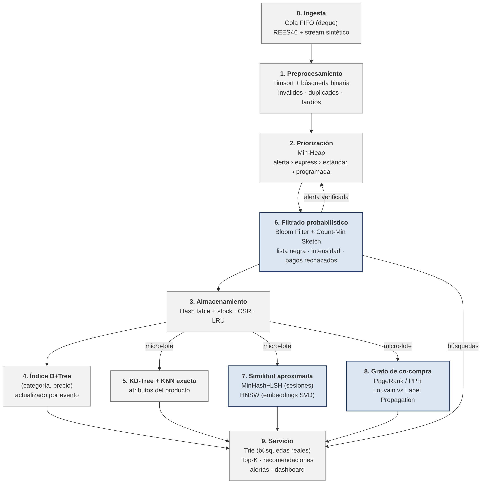

# Pipeline de data streams con estructuras de datos avanzadas · Comercio electrónico

Proyecto final del curso **Estructuras de Datos y Algoritmos (2026-2)** · Maestría en Ciencia de Datos e IA · UTEC Posgrado.
Escenario B: sistema de comercio electrónico sobre el dataset **eCommerce behavior data from multi-category store (REES46)**.

Un stream de 10 millones de eventos reales (vistas, carrito y compras) atraviesa un pipeline de diez etapas. Cada
etapa usa la estructura más adecuada y su salida alimenta a la siguiente, hasta producir alertas de fraude,
recomendaciones Top-K, consultas por rango, autocompletado y un panel de ventas.



## Etapas y dónde están implementadas

| Etapa | Estructura / algoritmo | Archivo | Salida observable |
|---|---|---|---|
| 0 Ingesta | Cola FIFO acotada (deque) | `src/estructuras/cola.py` | Eventos en orden de llegada |
| 1 Preprocesamiento | Timsort + búsqueda binaria (dedupe entre lotes), marca de agua | `src/pipeline.py` (`Preprocesador`) | Inválidos por motivo, duplicados y tardíos |
| 2 Prioridad | Min-heap: alerta › express › estándar › programada › carrito/búsqueda › vista | `src/estructuras/heap_prioridad.py` | Orden de atención |
| 3 Almacenamiento | Tabla hash con stock, matriz dispersa CSR, caché LRU | `src/estructuras/lru.py`, `src/pipeline.py` (`Almacen`) | Catálogo, disponibilidad, tasa de aciertos |
| 4 Índice | B+Tree (categoría, precio), actualizado evento a evento | `src/estructuras/bplustree.py` | Productos disponibles por rango de precio |
| 5 Multidimensional | KD-Tree + KNN exacto | `src/estructuras/kdtree.py` | Vecinos por atributos |
| 6 [FIJA] Filtrado | Bloom Filter + Count-Min Sketch por ventana | `src/estructuras/bloom.py`, `countmin.py` | Alertas verificadas: lista negra, intensidad, pago rechazado, prueba de tarjetas |
| 7 [FIJA] Similitud | MinHash + LSH; HNSW sobre embeddings SVD | `src/estructuras/minhash_lsh.py`, `hnsw.py` | Productos similares y complementarios |
| 8 [FIJA] Grafo | PageRank / PPR; Louvain vs Label Propagation | `src/estructuras/grafo.py` | Productos influyentes y comunidades |
| 9 Servicio | Trie (búsquedas reales), Top-K, dashboard | `src/estructuras/trie.py`, `topk.py`, `dashboard/app.py` | Autocompletado, más vendidos, panel |

**Procesamiento continuo:** las etapas 0–4 y el Trie se actualizan evento a evento. Las etapas costosas (5, 7 y 8) se
refrescan por micro-lotes cada `--refresco` eventos, así que las recomendaciones cambian mientras llega el stream;
las comunidades y su estabilidad se calculan al cerrar el stream.

Todas las estructuras son implementaciones propias. `networkx` se usa solo para Louvain y Label Propagation, y
`scipy` para la matriz dispersa y la SVD.

## Estructura del repositorio

```
├── src/
│   ├── preparar_datos.py      # CSV de Kaggle → stream de 10M con campos sintéticos
│   ├── pipeline.py            # orquesta las 10 etapas
│   └── estructuras/           # una estructura por archivo
├── experiments/benchmark.py   # escalabilidad 1K–10M, comparación con alternativas exactas
├── notebooks/                 # 01 exploración · 02 demo de punta a punta · 03 resultados
├── dashboard/app.py           # panel Streamlit
├── tests/                     # correctitud de cada estructura frente a su versión exacta
├── docs/                      # diagrama del pipeline e informe
└── data/                      # (no versionado) stream y lista negra
```

## Abrir el dashboard

**[Abrir dashboard local](http://127.0.0.1:8501)** · Requiere iniciar primero el servidor en tu computadora.

Este enlace apunta al equipo de quien lo abre. El README no inicia Python ni publica la aplicación. Para usar el panel, descarga el proyecto y abre una terminal en la carpeta que contiene `requirements.txt`, `src/` y `dashboard/`.


## Cómo ejecutarlo

**En Google Colab:** abre `notebooks/00_colab_paso_a_paso.ipynb`. Ejecuta todo el proyecto en orden (datos, pruebas, pipeline, comparación de algoritmos, escalabilidad y subida a GitHub).

**En local:**

```bash
pip install -r requirements.txt

# 1. Datos: descargar 2019-Oct.csv de Kaggle (ver data/README.md) y generar el stream
python src/preparar_datos.py --input ruta/2019-Oct.csv --n 10000000 --out data

# 2. Pruebas de las estructuras
python -m pytest tests -q

# 3. Pipeline de punta a punta (empezar con 200K eventos; luego subir --n)
python -m src.pipeline --stream data/stream_10M.parquet --blacklist data/blacklist.csv \
                       --stock data/catalogo_stock.csv --n 200000

# 4. Panel
streamlit run dashboard/app.py

# 5. Experimentos (1K a 1M; agregar --max 10000000 para 10M)
python experiments/benchmark.py --max 1000000 --reps 100

# 6. Resumen de resultados ordenado como las tablas 7.1–7.6 del informe y la diapositiva 14
python experiments/resumen_informe.py        # → outputs/resumen_para_informe.md
```

El pipeline imprime la traza de una compra express a través de las 10 etapas y guarda todas las métricas en
`outputs/resultados.json`. Los experimentos generan `experiments/resultados/benchmark.csv`, `plataforma.json` y
`escalabilidad_loglog.png`.

## Supuestos (detallados en la sección 2 del informe)

| # | Supuesto |
|---|---|
| S1 | Una orden es el conjunto de compras de una `user_session` (el dataset no trae identificador de orden). |
| S2 | Los timestamps son reales. El stream se reproduce por orden de llegada; ~1% de eventos llega con 1 a 30 minutos de retraso y se procesa igual (tolerancia de 2 h en las ventanas). |
| S3 | Tipo de orden de cada compra: express 10%, estándar 70%, programada 20%. |
| S4 | Cada usuario tiene 1–3 medios de pago y 1–2 dispositivos. |
| S5 | 0.5% de los usuarios son defraudadores, con ráfagas de 20 carritos y 6 compras en 2 minutos. Solo la mitad está en la lista negra. |
| S6 | Se rechaza el 2% de los pagos normales, el 50% de los pagos de defraudadores y el 60% de los de las ráfagas. |
| S7 | Ruido: ~1% de duplicados exactos y ~0.5% de registros inválidos. |
| S8 | El 15% de las sesiones empieza con una búsqueda (marca o tipo del primer producto visto). |
| S9 | Stock inicial sintético (5% agotado), sin reposición; una venta sin stock se registra como pedido pendiente. |
| S10 | Si el grafo de co-compra tiene menos de 1,000 aristas, se suman los carritos con peso 0.5. |
| S11 | Índices costosos refrescados por micro-lotes (por defecto, n/4 eventos con un máximo de 1M). |
| S12 | El B+Tree vive en memoria con páginas simuladas de orden 64 y eliminación perezosa. |
| S13 | La verificación exacta de alertas simula la consulta a la base de datos transaccional. |
| S14 | Umbrales por ventana de 10 min: 15 carritos, 5 compras y 3 pagos rechazados por medio de pago. |
| S15 | Devoluciones y reseñas quedan fuera del alcance: ninguna etapa obligatoria las requiere. |
| S16 | La interacción usuario-producto pesa 1 (vista), 3 (carrito) y 5 (compra); los pesos no se calibraron. |
| S17 | HNSW indexa los 5,000 productos con más interacción en cada micro-lote (está escrito en Python puro). |
| S18 | El grafo ignora órdenes de más de 50 productos; MinHash+LSH solo indexa productos vistos en al menos 5 sesiones. |

## Parámetros principales

- **Bloom Filter:** p = 1% sobre usuarios, medios de pago y dispositivos señalados.
- **Count-Min Sketch:** ε = 0.001, δ = 0.01, ventana deslizante de 10 minutos en bloques de 1 minuto.
- **MinHash + LSH:** 128 permutaciones, 64 bandas × 2 filas (umbral de Jaccard ≈ 0.125). El notebook de Colab compara
  otras configuraciones y muestra cuál cumple recall ≥ 0.8.
- **HNSW:** embeddings SVD de 32 dimensiones, M = 16, efConstruction = 100.

Participación Grupo 3 Exposicion

Javier Guerra Blanco,  Etapa 6: Filtrado probabilistico, Etapa 7 similitud aproximada, Etapa 8 y 9 Grafos de compra y servicio 
Armando Mesias Araujo, Dataset y datos sinteticos, supuestos de operación del pipeline
Brayan Quispe Montoya, Etapas del 0-2 y 3. 5: Ingesta, pre procesamiento, priorizacion, Almacenamiento, Indice Principal, Multidimensional
Raúl Pacheco Huanca, Experimentos y conclusiones

Todos: Implementación en python (Google Colab) y pruebas.


## Referencias principales

Bloom (1970) · Cormode y Muthukrishnan (2005) · Broder (1997) · Indyk y Motwani (1998) · Malkov y Yashunin (2020) ·
Brin y Page (1998) · Blondel et al. (2008) · Raghavan et al. (2007). Referencias completas en el informe.
